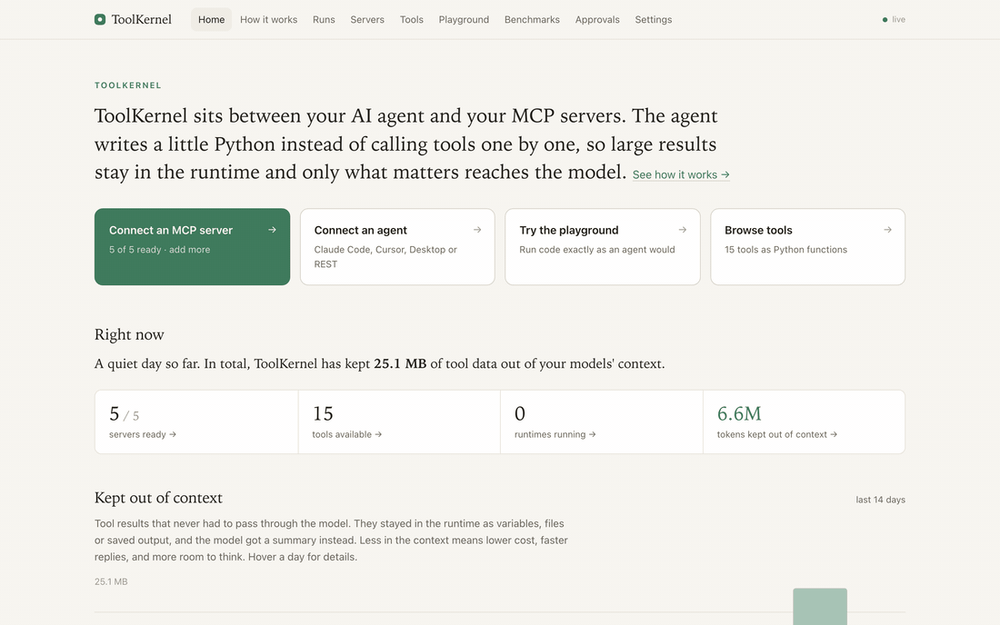
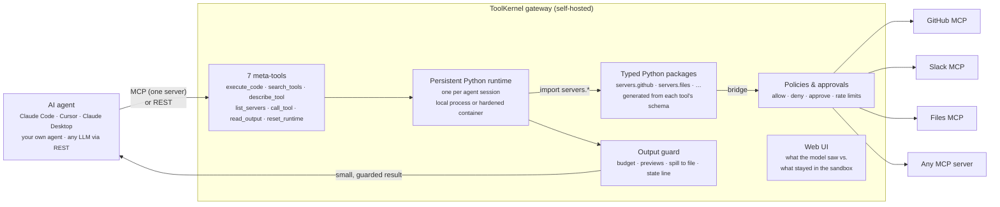
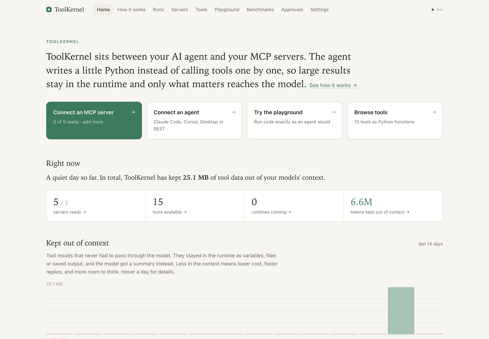
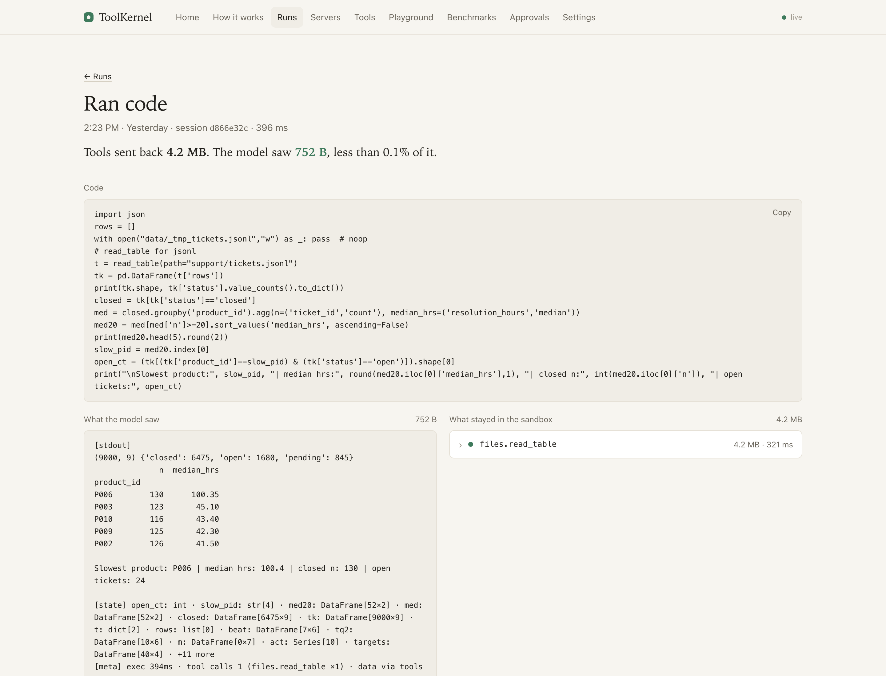
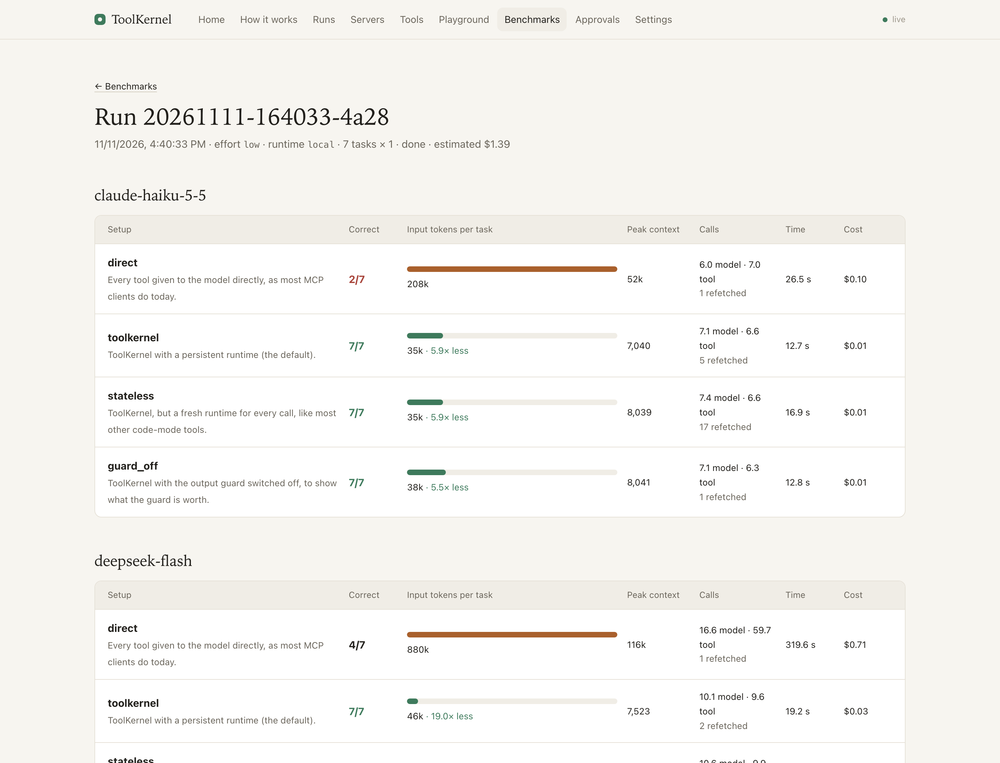
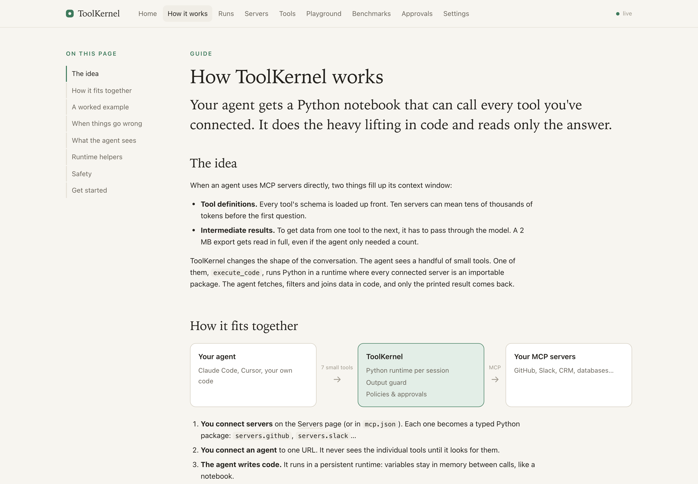

# ToolKernel

**A Python notebook for AI agents, wired to every MCP server you use.**

ToolKernel is a self-hosted gateway that sits between an AI agent (Claude Code, Cursor, your own agent) and your
MCP servers. Instead of calling tools one at a time and reading every result, the agent writes a few lines of
Python. Tool results land in Python variables, big data stays there, and the model only reads what it printed.

In our benchmark across three model families, agents using ToolKernel answered **20 of 21** data questions
correctly, against **8 of 21** with tools wired in directly. They read **~10× fewer input tokens** and cost
**~12× less**. [Results ↓](#benchmark-results)



---

## Contents

- [Why ToolKernel](#why-toolkernel)
- [How it works](#how-it-works)
- [What the agent sees](#what-the-agent-sees)
- [The web UI](#the-web-ui)
- [Quick start](#quick-start)
- [Benchmark results](#benchmark-results)
- [How the benchmark works](#how-the-benchmark-works)
- [Run the benchmark yourself](#run-the-benchmark-yourself)
- [How ToolKernel differs from existing solutions](#how-toolkernel-differs-from-existing-solutions)
- [Included tools](#included-tools)
- [Isolation and security](#isolation-and-security)
- [Configuration](#configuration)
- [Commands](#commands)
- [Project layout](#project-layout)
- [Tests](#tests)
- [Limitations and roadmap](#limitations-and-roadmap)
- [License](#license)

---

## Why ToolKernel

MCP made it easy to give an agent many tools. Two costs come with that:

1. **Every tool definition sits in the context.** Connect five servers with 80 tools, and every request carries
   their schemas, before the agent has done anything.
2. **Every tool result goes through the model.** Ask "what was EMEA revenue in Q3?" and the agent calls
   `read_table`, receives 24,000 rows (~8.5 MB of JSON), and has to read them to add up one column. It's slow and
   expensive. Often the result doesn't fit at all, or the model loses track of the details and gets the sum
   wrong.

People don't work like this. An analyst opens a notebook, loads the table into a variable, filters it and looks at
the one number they need. ToolKernel gives the agent that same notebook:

```python
from servers.files import read_table
orders = read_table(path="sales/sales_2025.xlsx", sheet="Orders")["rows"]   # 24,000 rows stay in Python
sum(o["revenue"] for o in orders if o["region"] == "EMEA" and o["order_date"][5:7] in ("07", "08", "09"))
```
```
[result]
15960536.65
[state] orders: list[24000]
[meta] exec 2747ms · tool calls 1 (files.read_table ×1) · data via tools 8.5 MB · returned 149 B
```

8.5 MB came back from the tool, and the model read 149 bytes. (Real output from the bundled sample data.)

---

## How it works



**Step by step:**

1. **You connect MCP servers** to ToolKernel, using the same `mcp.json` format as Claude Desktop and Claude Code.
   ToolKernel connects to each one and reads its tool list.
2. **It generates a typed Python package per server.** Every tool becomes a function with keyword arguments,
   type hints, a docstring and its return type, built from the tool's JSON Schema. `servers.github.list_issues(…)`
   is an ordinary Python function.
3. **The agent connects to ToolKernel as one MCP server.** It sees 7 small meta-tools (about 1k tokens), however
   many tools are behind them. It finds tools with `search_tools("…")` and reads a signature with
   `describe_tool(…)` only when it needs one.
4. **The agent writes code**, and `execute_code` runs it in a **persistent Python runtime** for that session.
   Variables, imports and functions survive between calls, like cells in a Jupyter notebook.
5. **Tool calls in the code go through a bridge** back to the gateway, which checks **policies** (allow, deny,
   rate limit, or wait for a person to approve), calls the real MCP server, and returns the result into Python.
   Credentials never enter the runtime.
6. **The output guard shapes what goes back.** Whatever the code printed or returned is kept within a budget
   (4,000 characters by default). Large values become previews (shape, keys and a few samples). Overflow is saved
   and can be paged with `read_output`. Every result ends with a `[state]` line listing what's in memory, and a
   `[meta]` line saying how much data the tools moved and how much the model received.
7. **The web UI records every step**, side by side: the code, what the model saw, and every tool call that
   stayed in the sandbox.

```mermaid
sequenceDiagram
    participant Agent
    participant TK as ToolKernel
    participant RT as Python runtime
    participant MCP as MCP server
    Agent->>TK: execute_code("orders = read_table(...); sum(...)")
    TK->>RT: run the code (variables persist)
    RT->>TK: read_table(path=...)  via bridge
    TK->>TK: policy check
    TK->>MCP: tools/call read_table
    MCP-->>TK: 24,000 rows (8.5 MB)
    TK-->>RT: rows → Python variable
    RT-->>TK: the result (one number)
    TK-->>Agent: [result] … [state] orders: list[24000] [meta] 8.5 MB via tools · 149 B returned
```

---

## What the agent sees

```python
from servers.github import list_issues
issues = list_issues(owner="acme", repo="api", state="open", labels=["bug"], per_page=100)
stale = [i for i in issues if i["updated_at"] < "2026-10-12"]
len(issues), len(stale)
```
```
[result]
(24, 13)
[state] stale: list[13] · issues: list[24]
[meta] exec 78ms · tool calls 1 (github.list_issues ×1) · data via tools 15.0 KB · returned 179 B
```

- **Variables persist** between calls. The `[state]` line reminds the model what's in memory (names, types and
  sizes, never values), so follow-up questions reuse data instead of fetching it again.
- **Careless output is guarded.** `print(issues)` returns head and tail within the budget. The full text is saved
  and can be paged with `read_output("o3fa21")`.
- **Big values preview themselves.** A 10,000-row result shows its shape, keys and three samples, not 2 MB of JSON.
- **Restarts are announced.** After an idle timeout or crash, the next result starts with
  `[runtime] Restarted since your last call (reason: idle timeout). All variables were cleared. Files in saved/ are kept: issues.json`.
- **Mistakes are caught before running.** A static check rejects `from servers.github import list_isues`
  (*Did you mean: list_issues?*) and unknown keyword arguments, without a runtime round trip.
- **Repetition is pointed out.** If an agent makes the same call three times in a row, the result says so.
- **Risky calls wait for a person.** Tools marked `destructiveHint`, such as posting to Slack, can be held until
  someone approves them in the web UI.

Helpers available in the runtime: `preview(x)`, `save(x, name)` / `load(name)` (files that survive restarts),
`stash` (a small key-value store kept by the gateway), `parallel(fn, kwargs_list)` and `search(query)`.

---

## The web UI

ToolKernel ships with a web UI at `http://localhost:7300`. It has no build step and no dependencies, and it's served by the gateway itself.

| | |
|---|---|
|  **Home.** What ToolKernel is, the main actions, and how much tool data was kept out of models' context. |  **Every step, side by side.** The code the agent ran, what the model saw (752 B), and what stayed in the sandbox (4.2 MB of tickets). |
|  **Benchmarks.** Every run, per model and setup, with a link to each task's full conversation. |  **How it works.** A guide with a worked example, built into the UI. |

Also included: **Servers** (add, restart and inspect upstream servers, with logs), **Tools** (every tool as a Python
signature), **Playground** (run code exactly as an agent would), **Approvals** (approve or deny held calls) and
**Settings**. Light and dark themes, with live updates.

---

## Quick start

Requires Python 3.12+ and [uv](https://docs.astral.sh/uv/).

```bash
git clone https://github.com/kkfaisal/toolkernel.git
cd toolkernel
uv sync
uv run toolkernel bench data            # sample company data for the bundled "files" server
cp mcp.example.json mcp.json            # mock GitHub/Slack/CRM + files + web; or paste your own servers
uv run toolkernel serve
```

Open <http://localhost:7300>. Then point an agent at it.

**Claude Code**
```bash
claude mcp add --transport http toolkernel http://localhost:7300/mcp
```

**Clients that only speak stdio** (e.g. Claude Desktop) use the bundled shim:
```json
{ "mcpServers": { "toolkernel": { "command": "/path/to/toolkernel/.venv/bin/toolkernel", "args": ["connect", "http://localhost:7300"] } } }
```

**Any LLM, without MCP:** `GET /v1/tools?format=openai|anthropic` returns tool definitions, and
`POST /v1/sessions/{id}/call` runs them.

**The built-in agent:** `toolkernel agent` is a small chat agent on the Claude API that prints every step as it
happens (needs `ANTHROPIC_API_KEY`; install with `uv sync --extra bench`).

```bash
uv run toolkernel agent "Which region grew most between Q1 and Q2?"
```

**Claude Code, headless:** `examples/claude-code-demo/run.sh` runs Claude Code with only ToolKernel connected (its
own shell, file and web tools switched off) on a multi-step business brief: Excel sheets, support tickets, a text
search, a web page and a Slack post that waits for approval. It writes a readable `transcript.md`.

---

## Benchmark results

> **Headline.** Three models from three providers, seven task types, four setups. With tools wired in directly,
> agents answered **8 of 21** correctly. Through ToolKernel they answered **20 of 21**, reading about a tenth
> of the input tokens at about a twelfth of the cost.

Run `20261111-164033-4a28`: 7 tasks × 1 run each, effort `low`, local runtime, prices from each provider's
pricing page.

### By model

| Model | Setup | Correct | Input tokens per task | Largest single request | Time per task | Cost (7 tasks) |
|---|---|:---:|---:|---:|---:|---:|
| **gpt-5-mini** (OpenAI) | Direct MCP | 2/7 | 438k | 120k | 47 s | $0.309 |
| | **ToolKernel** | **6/7** | **63k** | **6k** | 33 s | **$0.048** |
| | ToolKernel, stateless | 7/7 | 39k | 5k | 30 s | $0.046 |
| | ToolKernel, guard off | 6/7 | 36k | 5k | 23 s | $0.039 |
| **deepseek-flash** (DeepSeek) | Direct MCP | 4/7 | 880k | 116k | 320 s | $0.710 |
| | **ToolKernel** | **7/7** | **46k** | **8k** | 19 s | **$0.028** |
| | ToolKernel, stateless | 7/7 | 50k | 7k | 26 s | $0.035 |
| | ToolKernel, guard off | 7/7 | 53k | 8k | 21 s | $0.033 |
| **claude-haiku-5-5** (Anthropic) | Direct MCP | 2/7 | 208k | 52k | 26 s | $0.103 |
| | **ToolKernel** | **7/7** | **35k** | **7k** | 13 s | **$0.012** |
| | ToolKernel, stateless | 7/7 | 35k | 8k | 17 s | $0.013 |
| | ToolKernel, guard off | 7/7 | 38k | 8k | 13 s | $0.014 |

### All three models together

| Setup | Correct | Avg input tokens per task | Total cost |
|---|:---:|---:|---:|
| Direct MCP | 8/21 | 509k | $1.12 |
| **ToolKernel** | **20/21** | **48k** | **$0.09** |
| ToolKernel, stateless | 21/21 | 42k | $0.09 |
| ToolKernel, guard off | 20/21 | 43k | $0.09 |

### By task (Direct MCP → ToolKernel)

| Task | What it asks | gpt-5-mini | deepseek-flash | claude-haiku-5-5 |
|---|---|:---:|:---:|:---:|
| Single lookup | One customer's email from a 4,000-row CSV | ✓ → ✓ | ✓ → ✓ | ✓ → ✓ |
| Month-over-month change *(new)* | Biggest revenue jump between months, from 24,000 orders | ✗ → ✓ | ✗ → ✓ | ✗ → ✓ |
| Join two sheets | Which sales rep beat their Q2 target by the most | ✗ → ✓ | ✓ → ✓ | ✗ → ✓ |
| Search ticket text *(new)* | Tickets that mention renewal, and their top product | ✗ → ✓ | ✗ → ✓ | ✗ → ✓ |
| Three-step analysis | Three follow-up questions, each building on the last | ✗ → ✓ | ✓ → ✓ | ✗ → ✓ |
| Recover after restart | The runtime is restarted between two questions | ✗ → ✗ | ✗ → ✓ | ✗ → ✓ |
| Web search | Search the web (Tavily) and answer | ✓ → ✓ | ✓ → ✓ | ✓ → ✓ |

### What the numbers say

- **Direct MCP only succeeds when results are small.** All three models got the lookup and the web search right
  the direct way. Once a task needed a large table, they ran out of context (gpt-5-mini overflowed its 272k-token
  window once), summed only the rows they could see, or gave up.
- **A huge context window doesn't fix it.** deepseek-flash takes 1M tokens, so raw tables fit. It still missed 3
  of 7 the direct way, read **19× more input** than through ToolKernel, took **17× longer** (320 s against 19 s
  per task), and cost **25× more**.
- **The model never needs a big request with ToolKernel.** The largest single request stayed under 8k tokens for
  every model, against 52k–120k direct.
- **Persistent state means fewer re-fetches.** The stateless variant, where a fresh runtime runs every call (how
  most code-mode tools work), fetched the same data from tools again and again: about 2.5× more data moved
  through tools (418 MB against 138 MB across all models). Accuracy was the same in this run, so the benefit
  shows up as less work and lower load on your MCP servers, not as more correct answers.
- **The output guard matters when a tool returns something huge.** With the guard off, one gpt-5-mini run
  failed outright because a single result was over 1 MB.
- **The one ToolKernel miss:** after the forced restart, gpt-5-mini didn't reload the data and asked for the file.
  The restart notice was in its result, but it didn't act on it.

### Earlier, larger runs (gpt-5-mini only)

Before the three-model run, we ran 10 tasks × 3 repeats on gpt-5-mini. Those runs found **six real bugs** in
ToolKernel; we fixed them between runs:

- an empty `data/` folder in the runtime that made agents think there was no data;
- MCP SDK error messages that never reached the model;
- an empty filter that matched no files;
- two hints that pointed the model at the wrong tool;
- no warning when an agent repeated the same call.

ToolKernel's score went from **23/30** to **28/30**. Direct MCP scored **9/30** in both runs, with 0 correct on
every task that needs a large table.

### How much to trust these numbers

- **Strong:** the gap between Direct MCP and ToolKernel. It's large, consistent across three model families, and
  matches what the token counts predict.
- **Weak:** small differences between the ToolKernel variants (6/7 against 7/7). The final run uses one run per
  task, so a single success or failure is noise.
- **Some of the tasks tuned ToolKernel.** The bugs above were found on the original task set. The tasks marked
  *new* were written after those fixes, as a check against overfitting; ToolKernel passed all of them on every
  model.
- **It's one synthetic company and mostly data-analysis work,** at low reasoning effort. Results for code-heavy or
  write-heavy work may differ.
- Costs are estimates from list prices (DeepSeek at its peak-hour rate). Your provider's billing page is the
  source of truth.

All transcripts are saved, so every result can be checked: open the **Benchmarks** page and click any cell.

---

## How the benchmark works

In plain terms: we give a real AI agent a fake company's data and a list of questions with known answers, let it
work under each setup, and check its answers automatically.

1. **A fake company, the same every time.** [`bench/data.py`](src/toolkernel_gateway/bench/data.py) generates,
   from a fixed seed:
   - an Excel workbook with 24,000 orders, plus product and sales-target sheets;
   - 4,000 customers in a CSV file;
   - 9,000 support tickets in JSON Lines;
   - 30 weekly reports in Markdown;
   - some unrelated files as noise.

   Tricky details are there on purpose: a region code "NA" (North America) that naive parsers read as "missing",
   duplicate-looking company names, and product names that are prefixes of each other ("Storage Node" and
   "Storage Node Max").
2. **Questions with computed answers.** [`bench/tasks.py`](src/toolkernel_gateway/bench/tasks.py) defines 16 tasks
   across lookups, large-table filtering, joins, text search, multi-turn analysis, a forced restart and web search.
   Each task's correct answer is computed from the data with pandas. Nobody grades by hand, and no model acts as
   judge.
3. **A real agent loop.** [`bench/harness.py`](src/toolkernel_gateway/bench/harness.py) calls the model's API
   directly (Anthropic, OpenAI or DeepSeek). The model chooses the tools, reads the results and decides when it's
   done, ending with `FINAL ANSWER: …`. Nothing about the model's behaviour is scripted.
4. **Four setups, same everything else.** Each task runs under each setup, with the same model, system prompt,
   data, MCP servers and server instructions:

   | Setup | What the agent gets |
   |---|---|
   | `direct` | Every MCP tool given to the model directly, as MCP clients do today. Each result is capped at 100,000 characters, roughly Claude Code's limit. |
   | `toolkernel` | ToolKernel's 7 meta-tools, with a persistent runtime (the default). |
   | `stateless` | ToolKernel, but a fresh runtime for every `execute_code`, like most other code-mode tools. |
   | `guard_off` | ToolKernel with the output guard switched off, to show what the guard is worth. |

5. **Automatic checking.** Numbers must be within a small tolerance, and names must match exactly ("Storage Node"
   doesn't count for "Storage Node Max"). The checker reads only the final answer.
6. **Measured for every task run:** correct or not, input tokens (including cached), the largest single request,
   output tokens, model calls, tool calls, repeated identical fetches, bytes moved by tools, characters sent to
   the model, time, and cost. The full transcript is saved too.
7. **Fairness rules.**
   - Rate-limit and overload errors are waited out and retried, never scored as failures. A task that still
     can't run is excluded and counted in the report.
   - A run stops early on account errors such as an exhausted budget or a bad key.
   - Prompt caching is on for every setup.

Reports go to `.toolkernel/bench/<run>/`: `report.md`, `results.jsonl`, `meta.json` and one transcript per task.
[`bench/report.py`](src/toolkernel_gateway/bench/report.py) builds the tables, and the **Benchmarks** page in the
web UI shows them.

---

## Run the benchmark yourself

1. **Install** with the benchmark extras:
   ```bash
   uv sync --extra bench
   ```
2. **Generate the sample data.** It's deterministic, so everyone gets the same files:
   ```bash
   uv run toolkernel bench data
   ```
3. **Check the plumbing for free.** A scripted stand-in replaces the model, with no API calls:
   ```bash
   uv run toolkernel bench run --llm scripted --tasks lookup_email,emea_q3_revenue
   ```
4. **Set API keys** for the models you want to test. Each model is sent to its provider by name:
   ```bash
   export ANTHROPIC_API_KEY=...     # claude-*
   export OPENAI_API_KEY=...        # gpt-*, o*
   export DEEPSEEK_API_KEY=...      # deepseek-*
   export TAVILY_API_KEY=...        # optional: web search tasks (or BRAVE_API_KEY)
   ```
5. **Run.** It prints the plan, asks before spending, and stops at `--max-cost`:
   ```bash
   # the run above: one task of each type, three models, one run each (about $1.50)
   uv run toolkernel bench run \
     --models gpt-5-mini,deepseek-flash,claude-haiku-5-5 --effort low \
     --tasks lookup_email,best_month,rep_vs_target,renewal_tickets,explore_region,restart_recovery,web_search \
     --repeats 1 --max-cost 15

   # everything, three runs each
   uv run toolkernel bench run --models claude-haiku-5-5 --repeats 3 --max-cost 20
   ```
6. **Read the results** in `.toolkernel/bench/<run>/report.md`, or start `uv run toolkernel serve` and open the
   **Benchmarks** page.

Useful options:

| Option | What it does |
|---|---|
| `--configs direct,toolkernel,stateless,guard_off` | Which setups to compare |
| `--tasks <ids or categories>` | e.g. `join,web` or `best_month`; `uv run toolkernel bench tasks` lists them |
| `--repeats N` | Run each task N times |
| `--effort low\|medium\|high` | Reasoning effort for models that support it |
| `--price IN,OUT,CACHED` | $ per million tokens, for models without a built-in price |
| `--concurrency N` | Tasks in parallel (lower it if your provider rate-limits you) |
| `--driver docker` | Run ToolKernel's runtimes in hardened containers |
| `--no-web` | Skip tasks that need the internet |

To add your own tasks, add a `Task(...)` to [`bench/tasks.py`](src/toolkernel_gateway/bench/tasks.py) with the
question, a function that computes the right answer from the data, and a checker.

---

## How ToolKernel differs from existing solutions

The idea of letting agents write code against tools instead of calling them one by one has been described
before, notably in Cloudflare's *Code Mode* and Anthropic's *Code execution with MCP*. ToolKernel's focus is
making that idea a **self-hosted gateway you can put in front of any agent today**, with state, guard rails and
measurement included.

| | Plain MCP client | Tool-search / deferred loading | MCP gateways & aggregators | Hosted code-mode runtimes | **ToolKernel** |
|---|---|---|---|---|---|
| Tool definitions in context | all of them | only the ones searched for | all (merged) | a typed API | **7 meta-tools, ~1k tokens** |
| Tool results go through the model | always | always | always | no | **no: they stay in Python** |
| State between steps | n/a | n/a | n/a | usually a fresh sandbox per run | **persistent per session, with a `[state]` line and restart notices** |
| Works with any MCP client | yes | client-specific | yes | tied to a platform or SDK | **yes: one MCP server, or REST for any LLM** |
| Output guard (budget, previews, paging) | client caps or truncates | no | no | partial | **yes** |
| Static check before running code | n/a | n/a | n/a | rare | **yes: names, imports, keyword arguments** |
| Policies and human approval | client-dependent | no | some | rare | **allow / deny / approve / rate-limit, approvals in a UI** |
| Shows what the model saw vs. what it didn't | no | no | some logging | no | **yes, every step** |
| Benchmark you can rerun | no | no | no | no | **included** |
| Runs on your machine | yes | depends | yes | usually hosted | **yes, no cloud services** |

What's specific to ToolKernel:

- **Stateful by design.** Most code-mode systems run each snippet in a fresh sandbox. ToolKernel keeps a notebook
  per agent session, tells the model what's in memory after every step, and says plainly when a restart cleared
  it. In the benchmark, stateless runs moved about 2.5× more data through tools.
- **Python, with real types.** Every MCP tool becomes a typed Python function, so agents get pandas and the
  standard library for free, and mistakes are caught before running.
- **Client-agnostic.** It's one MCP server for Claude Code, Cursor or Claude Desktop, and a REST API with OpenAI
  and Anthropic tool formats for everything else. Your existing MCP servers don't change.
- **Observable.** The UI shows, for every step, the code, what the model received and what stayed in the sandbox,
  with exact byte counts.
- **Measured.** The benchmark ships with the code, and its results include the failures and the bugs it found.

*This comparison describes categories in general. Specific products change quickly; corrections are welcome.*

---

## Included tools

Two real MCP servers ship with ToolKernel, both in `mcp.example.json`:

- **files**: read-only access to one folder of data: Excel (every sheet), CSV, JSON / JSON Lines, Parquet and
  text. Its tools are `list_files`, `describe_file`, `read_table` (columns, equality filters, paging), `read_text`
  and `search_text`. Paths can't leave the folder, and text such as "NA" stays text.
- **web**: `web_search` (Tavily with `TAVILY_API_KEY`, or Brave with `BRAVE_API_KEY`) and `fetch_url`, which
  returns a page's readable text. Private and local addresses are refused. HTTPS uses the operating system's
  certificate store, so it also works behind corporate TLS inspection.

```bash
uv run python -m toolkernel_gateway.mcp_servers.files --root ./my-data
TAVILY_API_KEY=... uv run python -m toolkernel_gateway.mcp_servers.web
```

`examples/` also has three mock servers (GitHub, Slack and a CRM) for trying things without any accounts.

---

## Isolation and security

By default, runtimes are **local processes**. That's fine on your own machine with code you trust, but it is
**not a sandbox**. For anything else, use Docker:

```bash
uv run toolkernel build-runtime          # builds toolkernel/runtime:1 (python:3.12-slim + pandas)
uv run toolkernel serve --driver docker
```

Each session then gets its own container:
- read-only root filesystem;
- all Linux capabilities dropped, and `no-new-privileges`;
- a non-root user;
- CPU, memory and process limits;
- optional gVisor (`runtime.hardened: true`).

With `runtime.network: isolated` (the default), containers sit on an internal Docker network whose only exit is a
small relay to the gateway's bridge. Code can call tools but can't reach the internet. Runtimes never see upstream
credentials; each session's bridge token only works for that session.

Set `TOOLKERNEL_API_KEY` to require `Authorization: Bearer <key>` on `/mcp`, `/v1` and `/api`. Keep secrets out of
`mcp.json`: write `${secret:name}` (read from `TOOLKERNEL_SECRET_<NAME>` or `.toolkernel/secrets.json`) or
`${env:NAME}`.

---

## Configuration

Everything has a sensible default. Copy `toolkernel.example.yaml` to `toolkernel.yaml` to change ports, output
budgets, runtime limits or policies:

```yaml
policies:
  rules:
    - match: "*"
      when: { annotation: destructiveHint }
      action: approve            # wait for a person in the web UI
    - match: "github.delete_*"
      action: deny
    - match: "salesforce.*"
      rate_limit: { calls: 60, per: minute }
```

Upstream servers live in `mcp.json`, in the same `mcpServers` format as Claude Desktop and Claude Code. Edits are
picked up automatically. You can also add servers in the web UI or with `toolkernel add <name> --url … | --command …`.

---

## Commands

| Command | What it does |
|---|---|
| `toolkernel serve` | Run the gateway: MCP at `/mcp`, REST at `/v1`, web UI at `/` |
| `toolkernel agent [question]` | Chat agent on the Claude API that uses the gateway |
| `toolkernel generate` | Connect to upstreams, write the Python packages, exit |
| `toolkernel add` / `remove` | Edit `mcp.json` |
| `toolkernel connect URL` | stdio ↔ HTTP shim for stdio-only clients |
| `toolkernel build-runtime` | Build the Docker runtime image |
| `toolkernel bench data \| run \| report \| tasks` | The benchmark |

---

## Project layout

```
src/toolkernel_gateway/
  app.py            HTTP app: MCP endpoint, REST API, web UI routes, the bridge
  gateway.py        sessions, the 7 meta-tools, the bridge, policies and approvals
  generator.py      MCP tool schemas → typed Python packages
  runtime.py        runtime drivers: local process or hardened Docker container
  guard.py          the output guard: budgets, previews, spill files, paging
  upstream.py       connections to MCP servers (stdio, HTTP, SSE), reconnects, refresh
  policy.py         allow / deny / approve / rate-limit rules
  search.py         BM25 search over tools
  static_check.py   catches bad imports and arguments before running code
  agent.py          the `toolkernel agent` chat agent
  runtime_lib/      code that runs inside the runtime (executor, bridge client, helpers)
  mcp_servers/      the bundled files and web MCP servers
  bench/            benchmark data, tasks, harness and reports
  ui/               the web UI (vanilla JS, no build step)
examples/           mock MCP servers and the Claude Code demo
runtime/Dockerfile  the runtime container image
tests/              unit and end-to-end tests
```

---

## Tests

```bash
uv run pytest                                   # unit + end-to-end (local runtimes)
TOOLKERNEL_TEST_DOCKER=1 uv run pytest          # also the Docker driver and its network isolation
```

The end-to-end tests start a real gateway, real MCP servers over stdio and a real MCP client. They cover:
- discovery and persistent state;
- guarded output and paging, and the static check;
- idle restart and recovery from `saved/`;
- approvals, timeouts and REST;
- the benchmark harness with a scripted model;
- with Docker, that a runtime can't reach the internet.

---

## Limitations and roadmap

- **Local runtimes are not isolated.** Use `--driver docker` for code you don't trust.
- The gateway runs on the host and starts runtime containers. There is no all-in-Docker deployment yet.
- No warm pool yet. A local runtime starts in 0.1–0.2 s, and a container in about 0.4 s.
- `secrets.json` is plain text, not encrypted.
- Approvals happen in the web UI. MCP elicitation, circuit breakers and PII masking aren't built.
- The benchmark covers one synthetic dataset, mostly data analysis, and doesn't yet compare against other
  code-mode tools directly.
- Planned: learning result shapes from real calls, embedding-based tool search, saved snippets, and OAuth for
  upstream servers.

---

## License

[Apache 2.0](LICENSE)
